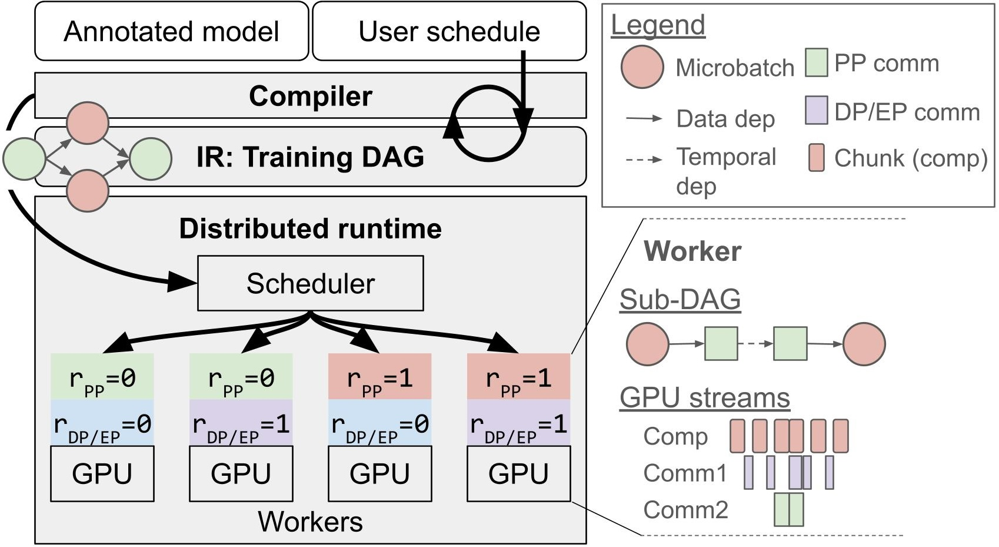

per: A Programmable Distributed Training System

[](https://arxiv.org/abs/2606.11169)

New distributed training strategies should not require new distributed runtimes; Piper gives PyTorch users direct control over model placement and GPU scheduling with lightweight annotations and a small scheduling language.

## Updates

* 2026-06 - Blog post: [Introducing Piper: A Programmable Distributed Training System](https://syfi.cs.washington.edu/blog/2026-06-05-piper/).
* 2026-06 - Paper released on arXiv: [2606.11169](https://arxiv.org/abs/2606.11169).

## Introduction

Large training jobs increasingly combine multiple parallelism strategies such as pipeline, data, and expert parallelism with ZeRO-style sharding, creating placement and GPU scheduling choices that current frameworks cannot express cleanly.
Today, ML researchers and practitioners choose between one-off specialized systems that perform well but are hard to adapt, and general-purpose frameworks that are easier to use but expose limited control.

Piper is a user-controllable distributed training system for PyTorch that separates model placement and GPU scheduling from model code and runtime implementation.
With lightweight model annotations and a small scheduling language, Piper lets users express, visualize, profile, and run high-performance training schedules such as DualPipe-style pipeline- and expert-parallel overlap.

## Architecture



Piper has two user-facing inputs:

* An annotated PyTorch model: standard model code with lightweight tags for schedulable regions such as pipeline stages and routed computation.
* A schedule-directive program: instructions that tell the Piper compiler how to shard, replicate, order, and overlap those schedulable regions.

The compiler traces the model with TorchDynamo, splits the graph by Piper annotations, builds a distributed training DAG IR, and applies DAG rewrites according to the schedule directives.
The directive rewrites insert point-to-point pipeline communication,
DP collectives, ZeRO gather/scatter collectives, routed
EP all-to-all or M-to-N communication, temporal edges, rank
assignments, and logical stream assignments.


The runtime decomposes the global DAG into one execution plan per ActorGroup
(a SPMD group of ranks which execute different DP/EP shards of the same pipeline stage)
and sends it to every rank in that group. Each actor manages its local
CUDA streams, process groups/communicators, model-state buffers, and
intermediate tensors.

## Installation

Requires Python 3.10+ on Linux with CUDA GPUs.
The current setup has been tested with Python 3.10 and CUDA 12.x.

```bash
python3.10 -m venv .venv
source .venv/bin/activate
python -m pip install --upgrade pip
python -m pip install -e .
```

If you do not already have Python 3.10 locally:

```bash
conda create -n piper python=3.10 -y
conda activate piper
python -m pip install --upgrade pip
python -m pip install -e .
```

## Quickstart

From the repository root, run the Qwen example with a DualPipeV schedule:

```bash
python examples/test_harness.py \
  --test-file examples/test_qwen.py \
  --base-schedule examples/base-schedules/pp4_dp2_ep2_v_placement.json \
  --schedule dualpipev \
  --ranks 2 \
  --mbs 4
```

The legacy-named base schedule `pp4_dp2_ep2_v_placement.json` maps four
annotated pipeline regions onto two ActorGroups in a V layout. Regions `PP=0`
and `PP=3` run on the SPMD ranks `[0, 2]`, while `PP=1` and `PP=2` run on
`[1, 3]`. Within each ActorGroup, Piper replicates the dense regions and
route-shards the expert regions; the group width is not stored or interpreted
as a separate replication topology.
`replicate` and `shard` filters must select disjoint model regions; applying
both ownership modes to the same region is rejected. A `place` directive may
select either kind of region. For an EP schedule, use an absence filter such as
`{"PP": 0, "EP": "-"}` to replicate only the dense portion of a pipeline
stage and `{"PP": 0, "EP": "*"}` to shard its expert regions.
This example expects four visible CUDA devices.
The harness appends DualPipeV `split` and `order` directives for two
ActorGroups and four microbatches.

Run the Qwen example with PP x ZeRO-3 1F1B schedule:

```bash
python examples/test_harness.py \
  --test-file examples/test_qwen.py \
  --base-schedule examples/base-schedules/pp2_dp2_ep2_zero3.json \
  --schedule 1f1b \
  --ranks 2 \
  --mbs 4
```

The legacy-named base schedule `pp2_dp2_ep2_zero3.json` maps two pipeline
stages onto ActorGroups `[0, 2]` and `[1, 3]`. Its dense replicated regions use
ZeRO-3-style gradient and parameter sharding across their ActorGroup SPMD
ranks, while its expert regions use route ownership sharding.
This example also expects four visible CUDA devices.
The harness appends 1F1B `split` and `order` directives for two ActorGroups and
four microbatches.
Each run creates `out/<timestamp>/` with the complete generated schedule and metrics.

### Multi-host Ray

Piper does not discover remote hosts automatically. Start a Ray head on 
the first host, then join each worker node.
Use private IPs reachable over the interface that NCCL will use:

```bash
# Host 1
scripts/start_ray_head.sh --node-ip <head-private-ip>

# Host 2
scripts/join_ray_worker.sh \
  --head-address <head-private-ip>:6379 \
  --node-ip <worker-private-ip>
```

Then pass the head address to the harness with
`--address <head-private-ip> --port 6379`.

## Overview of Inputs

### Annotations

`piper.annotate(tag)` is a context manager that attaches Piper metadata to all PyTorch operations traced inside the scope.
The `tag` is a non-empty string naming a schedulable dimension of the model, such as `PP` for pipeline regions or `EP` for routed regions.
For each tag name, Piper assigns integer indices in trace order, so repeated `piper.annotate("PP")` scopes become `PP=0`, `PP=1`, and so on.

The schedule directives program uses the tag names and indices in filters to select regions of the traced model.
For example, a filter can select one concrete region by its tag index, all regions with a tag, or regions that match a combination of tags.
See the blog walkthrough section on [annotating a Qwen3 MoE model](https://syfi.cs.washington.edu/blog/2026-06-05-piper/#annotating-a-qwen3-moe-model) for an example and further details.

#### Tensor-routing interface for sharded regions

A region selected by a `shard` directive must explicitly identify the three
tensors used by routed dispatch and combine: `mark_combine_payload`, `mark_dispatch_counts`, and `mark_dispatch_payload`.

```python
from src.piper import (
    annotate,
    mark_combine_payload,
    mark_dispatch_counts,
    mark_dispatch_payload,
)

payload = mark_dispatch_payload(payload)
counts = mark_dispatch_counts(counts)
with annotate("EP"):
    expert_output = experts(payload, counts)
    expert_output = mark_combine_payload(expert_output)
```

These functions are trace-preserved tensor identities. They let Piper insert
routed communication without requiring specific operators or expert patterns.
Every routed region must be one
contiguous annotated segment with exactly one marker of each kind; the two
dispatch markers must cross its immediately preceding annotation boundary and
the combine marker must cross its immediately following boundary.

The routed tensor interface is:

* At the source boundary, `dispatch_payload` has shape `[rows, hidden]`. Its rows 
  are grouped by global route in route-index order, and `dispatch_counts[0, route]` 
  gives the number of rows in each group.
* The annotated source-side `dispatch_counts` tensor has shape
  `[1, num_global_routes]`. It is a nonnegative, non-differentiable integer
  tensor, and `dispatch_counts[0, route]` is the number of payload rows assigned to 
  that route.
* After communication, Piper presents the routed region with `dispatch_counts` shaped
  `[num_source_ranks, num_local_routes]` and `dispatch_payload` packed in source-major,
  then local-route-major order. Entry `dispatch_counts[source, route]` gives the number of 
  payload rows assigned to that source/route pair. Piper does not perform model-specific 
  regrouping or padding. The sharded region's model code is responsible for, e.g., regrouping
  `dispatch_payload` by local expert. 
* `combine_payload` is the only dynamic output. It must contain one result row
  per received row, in the same source-major/local-route order. The sharded region's 
  model code is responsible for un-doing any regrouping that it applied to `dispatch_payload`.
* Both `dispatch_payload` and `dispatch_counts` must be graph ancestors of `combine_payload`, and no
  other dynamic value may be consumed or produced by the routed region.
  Parameters, buffers, constants, and derived symbolic sizes are allowed.
  Values unused by the region may bypass it; if the source and destination regions are on the same
  ActorGroup, then Piper keeps those values local, otherwise it sends them directly via P2P rather
  than routing them through the sharded region.

The model author must pack source rows according to `dispatch_counts` and undo
any model-side row permutation before marking `combine_payload`. Piper checks
the marker placement, dependencies, tensor schemas, counts, and row totals,
but cannot prove that rows were assigned to or restored from the correct
routes -- it is the responsibility of the user to guarantee this. 

### Schedule Directives Program

A schedule directive program is a JSON array of directive objects.
Each directive has an `op` string naming the rewrite to apply to the distributed training DAG IR.
Most directives use a `filter` object to select the model region to apply the directive to.
The `order` directive uses `filters` to describe a sequence of filter groups.
A `filter` is a JSON object whose keys are tag names and whose values are the tag indices to match.

Filter keys can refer to annotation tags, new tags added by previous directives, or the compiler-provided `PASS` tag which supports `F` (forward), `B` (backward), `BI` (backward for inputs), and `BW` (backward for weights) for different training step stages.
Filter values can be tag indices, `"*"` to match any concrete index for the
key, or `"-"` to match only nodes on which that key is absent.

The empty filter `{}` matches the entire DAG IR.
All key/value pairs in a filter are conjunctive, so `{"PP": 1, "EP": "*"}` matches nodes that are in pipeline region `PP=1` and have any `EP` index.

Supported directives:

Before applying individual directives, Piper interprets each distinct
`place.devices` set as one SPMD ActorGroup. The listed integers are global SPMD-rank
IDs. Every `replicate` or `shard` device set
must exactly match a `place` ActorGroup; partially overlapping or nested device
sets are rejected. The input microbatch is split evenly over the input
ActorGroup, so its batch dimension must be divisible by that
ActorGroup's size.

* `place` assigns matched compute regions to an ActorGroup and names the
  logical stream used for inserted PP send/receive communication (under the hood,
  opposite P2P directions are mapped onto different directional physical low-to-high and
  high-to-low streams and communicators to avoid deadlock). If any
  placement supplies `stream`, all placement directives that supply it must
  agree.
  * `op`: `"place"`
  * `filter`: Selects the model regions to place.
  * `devices`: Non-empty list of global SPMD-rank IDs for the ActorGroup.
  * `stream`: Optional logical stream name for inserted point-to-point communication.
* `replicate` materializes the matched region on every SPMD rank in an
  ActorGroup and averages its gradients once per training step across that group.
  * `op`: `"replicate"`.
  * `filter`: Selects the model regions to replicate.
  * `devices`: ActorGroup device list, exactly matching a `place` directive.
  * `reduce_stream`: Optional logical stream name for gradient synchronization collectives.
  * `gather_stream`: Optional logical stream name for ZeRO-3 parameter materialization collective communication.
  * `bucket_size`: Optional parameter bucket size in MB for finer-grained synchronization.
  * `shard_grads`: Optional boolean enabling ZeRO-2-style gradient sharding.
  * `shard_params`: Optional boolean enabling ZeRO-3-style parameter sharding.
* `shard` assigns equal contiguous route ranges (i.e. expert ranges, in the case of EP) to the
  SPMD ranks in an ActorGroup and inserts routed communication around the matched region.
  If the regions surrounding the matched sharded region all belong to the same ActorGroup,
  the routed communication lowers to ragged all-to-all; if the surrounding regions belong
  to a different ActorGroup, the routed communication lowers to M-to-N or N-to-M communication. The
  number of global routes must be divisible by the shard degree, and
  `devices` must be written in ascending global-rank order.
  * `op`: `"shard"`
  * `filter`: Selects the model regions to shard.
  * `devices`: ActorGroup device list, exactly matching a `place` directive.
  * `stream`: Optional logical stream for inserted routed communication.
* `split` duplicates the matched DAG by a named microbatch dimension.
  Currently it only handles duplicating the entire DAG.
  * `op`: `"split"`
  * `filter`: Selects the sub-DAG to duplicate.
  * `dim_name`: Non-empty string naming the new split dimension.
  * `num_microbatches`: Positive integer number of copies to create.
* `order` adds temporal dependencies between filter groups.
  * `op`: `"order"`
  * `filters`: List of at least two non-empty filter groups.
  * Each filter group is a list of filter objects that occupy the same ordering slot.
  * Consecutive filter groups create temporal dependencies from one slot to the next.
  * Multiple filters in the same group permit Piper to interleave those sub-DAGs.

In practice, base schedules under `examples/base-schedules/` describe model placement and composed parallelism choices, while `examples/test_harness.py` appends generated `split` and `order` directives for schedule families such as `1f1b`, `interleaved_1f1b`, `zerobubble`, and `dualpipev`.
For more detail, see the blog walkthrough sections on [replicated-dense and expert-sharded placement](https://syfi.cs.washington.edu/blog/2026-06-05-piper/#scheduling-dualpipe-like-pp-x-dp-x-ep-model-placement), [DualPipe-like pipeline scheduling](https://syfi.cs.washington.edu/blog/2026-06-05-piper/#scheduling-a-dualpipe-like-pipeline-schedule), and [schedule builders](https://syfi.cs.washington.edu/blog/2026-06-05-piper/#generating-directives-with-schedule-builders).

## Overview of Outputs

Every harness run creates a timestamped directory under `out/`:

```text
out/<timestamp>/
|-- <schedule>_pp<ranks>_mbs<mbs>.json
`-- results.csv
```

`results.csv` contains one row for the training program, including ActorGroup
count, total SPMD world size, raw-distribution summaries and percentage
uncertainty for iteration time and training throughput, and peak-memory
columns for each global SPMD rank. With
`--profile-and-simulate`, the run directory also contains the reusable
multi-mode profile JSON and normal/interference-free simulation statistics.

Optional artifact generation flags:

* `--viz` renders the generated pipeline schedule and per-ActorGroup DAG IRs under the run directory.
* `--pytorch-profiler --pytorch-profiler-iters <n>` runs extra profiled iterations and writes combined Chrome trace files per SPMD rank; Piper annotates GPU events with DAG IR node labels.
* `--profile-and-simulate` collects interference-free and normal node profiles,
  replays both, and reports normal-replay prediction error. `--profile-iters`
  sets the exact measured iteration count for each mode and
  `--profile-warmup-iters` sets its warmup count.
* Normal hardware timing runs exactly `--iters` measured iterations after
  `--warmup` warmup iterations.

## Citation

If you use Piper in your research, please cite:

```bibtex
@misc{frisella2026piperprogrammabledistributedtraining,
      title={Piper: A Programmable Distributed Training System}, 
      author={Megan Frisella and Shubham Tiwari and Andy Ruan and Yi Pan and Parker Gustafson and Mat Jacob and Gilbert Bernstein and Stephanie Wang},
      year={2026},
      eprint={2606.11169},
      archivePrefix={arXiv},
      primaryClass={cs.DC},
      url={https://arxiv.org/abs/2606.11169}, 
}
```

